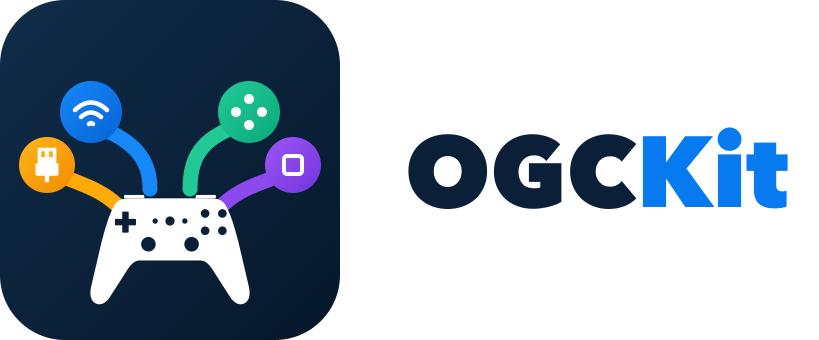

<p align="center">
  <picture>
    <source media="(prefers-color-scheme: dark)" srcset="assets/brand/ogckit-logo-color-dark.svg">
    <source media="(prefers-color-scheme: light)" srcset="assets/brand/ogckit-logo-color-light.svg">
    
  </picture>
</p>

# OGCKit — Open Game Controller Kit

OGCKit aims to be a universal controller-input library for console homebrew and
emulators: one small C API for reading different controllers across platforms.
The goal is to let applications work with a common input state rather than handle
each controller protocol and platform connection themselves.

**Early proof of concept.** Version `0.1.0` is tentative. Universal coverage is the
goal, not today's support level; the API, drivers, and backends may change.

## How it fits

Protocol **drivers** interpret controller reports. Platform **backends** connect
to devices. Keeping these separate allows controller and platform support to grow
incrementally without changing how an application reads input.

The current implementation provides a read-only C API, device discovery, and
input snapshots. Protocol support includes Xbox 360-class XInput reports,
captured Switch-Pro-compatible USB reports from the tested Miadore N64 receiver
in Mode A, and narrowly scoped Bluetooth HID input for observed GBros X-Input
and Switch-compatible report layouts. Live Miadore Mode A discovery and input
through macOS IOHID are verified for the tested receiver: buttons, both stick
axes, and digital Z/ZR trigger states.
In the receiver's XInput mode, macOS identifies it as `045E:028E` and live
button and left-stick reports are decoded. Isolated tests also confirmed
digital Z-to-LT and ZR-to-RT mappings, while C-direction buttons changed button
bits as expected for the N64 controller; a second analog stick is not expected.
For Bluetooth, matching is limited to the observed GBros X-Input identity
(`045E:02E0`) and Switch-compatible identity (`057E:2009`) and their captured
report layouts. The same `057E:2009` identity can represent different physical
adapter modes, so mode is not inferred. The IOHID reader
intermittently drops and rediscovers the pad, with macOS logging USB babble
errors and resets; short successful runs do not establish stability. Right
stick axes are not part of this controller's N64 layout. The cause of the
intermittent loss remains undetermined.
Available backends are libusb for desktop development, macOS IOHID for system
HID devices, and PS4 `sceUsbd` through OpenOrbis/PacBrew. A backend's availability
is not a guarantee that every controller works on that platform.

The versatile 8BitDo GBros. in XInput mode is a useful initial test platform,
not the project's purpose or a promise of universal adapter support. Tested paths
include macOS input and GameCube button input on PS4; see the scoped
[hardware evidence](docs/development.md#hardware-evidence).

## Try it

For desktop development, install CMake, a C++17 compiler, pkg-config, and libusb
1.0 development files:

```sh
cmake -S . -B build -DOGC_BACKEND=libusb
cmake --build build
build/ogc-terminal
```

On macOS, use `-DOGC_BACKEND=iohid` instead to use the system HID driver without
libusb. For PS4 cross-builds, integration, logging, and hardware-free tests, see the
[developer guide](docs/development.md). The public API is in
[`include/ogckit.h`](include/ogckit.h).

## Current limits and direction

Bluetooth input exists only for the scoped macOS devices and report layouts
above; broader Bluetooth/controller coverage is planned. Rumble, including
separate motors, is not implemented. Additional support will be added
incrementally—not universal support already delivered.
See the [implemented / planned / unknown roadmap](ROADMAP.md).

PS4 has a confirmed, setup-specific button-input path, not broad compatibility or
long-run validation. An unresolved `sceUsbd` device-list ownership/ABI issue may
retain device references across scans; the
[PS4 resource-risk notes](docs/development.md#ps4-backend-and-resource-risk) remain
important for developers evaluating that backend.

## License

[MIT](LICENSE). OGCKit is not related to libogc.

The source code is MIT-licensed. The branding artwork in `assets/brand/`
(logos and icons) is separate from the code and is licensed under
[CC BY 4.0](https://creativecommons.org/licenses/by/4.0/); attribution:
`kaeptnphl`. No trademark rights in any product or project names or marks are
granted.
